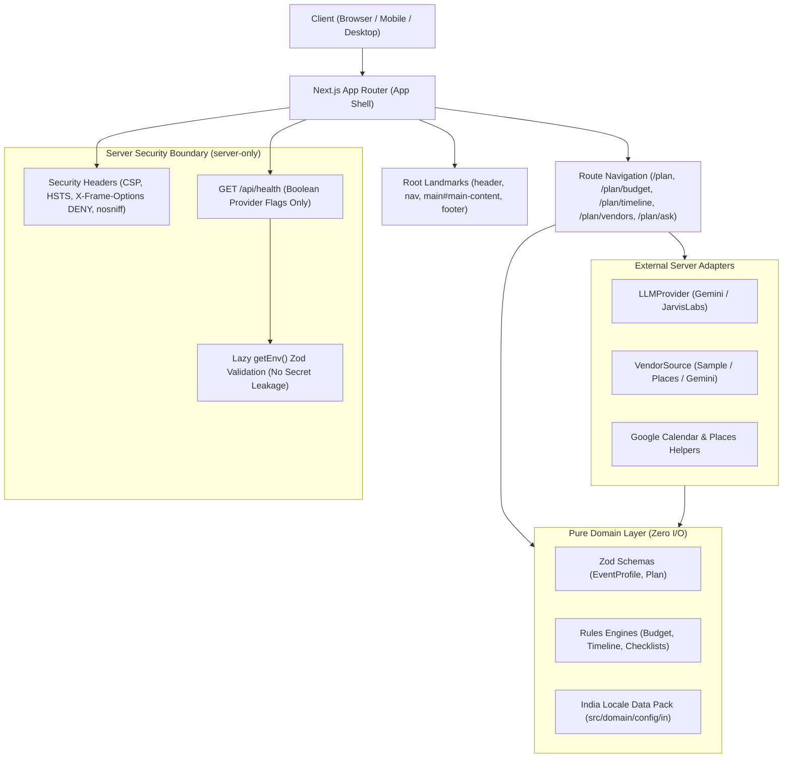

# Utsav Planner

> **Single Source of Truth Brand Name**: Defined in [`src/lib/brand.ts`](file:///Users/arnav/Desktop/event_planner/src/lib/brand.ts) as `BRAND_NAME = "Utsav Planner"`.

---

## 1. Problem Statement (Verbatim)

> "A GenAI celebration & event planner for India (weddings, birthdays, community festivals) covering budgets, timelines, vendor checklists and personalized ideas. It is graded by an AI on: Code Quality, Security, Efficiency, Testing, Accessibility, Google Services usage, Problem Statement Alignment. This phase is SCAFFOLDING ONLY: structure, config, tooling, design system, shell UI. Do NOT implement planning logic, LLM calls or vendor logic yet."

---

## 2. How Each Requirement Is Met

| Requirement Area       | Problem Need                                                                          | Scaffolded Architectural Feature                                                                     | Planned Phase 2 Feature                                                                                               |
| :--------------------- | :------------------------------------------------------------------------------------ | :--------------------------------------------------------------------------------------------------- | :-------------------------------------------------------------------------------------------------------------------- |
| **Budgets**            | Deterministic per-plate and category cost breakdowns for Tier 1/2/3 cities.           | Route `/plan/budget`, empty state with navigation, schema stubs in `src/domain/rules/`.              | `src/domain/rules/budget.ts` splitting budget across decor, venue, catering, and rituals with mathematical precision. |
| **Timelines**          | Backward-scheduled Indian cultural milestones (muhurat, booking, tailoring).          | Route `/plan/timeline`, milestone placeholder cards, lead-time pack stub in `src/domain/config/in/`. | `src/domain/rules/timeline.ts` computing scheduling milestones backwards from event date with Google Calendar export. |
| **Vendor Checklists**  | Coordinator checklists and localized vendor lookup across Indian event categories.    | Route `/plan/vendors`, `VendorSource` interface stubs in `src/server/vendors/`.                      | Concrete adapters for `SampleVendorSource` (offline curated dataset) and `GooglePlacesVendorSource` (live lookup).    |
| **Personalized Ideas** | Creative themes, menu recommendations, and ritual itineraries tailored to traditions. | Route `/plan/ask`, interactive empty state, `LLMProvider` interface in `src/server/llm/`.            | Multi-model GenAI integration routing to Google Gemini and JarvisLabs (Gemma 4 31B IT) with prompt sanitization.      |

---

## 3. Architecture Diagram



---

## 4. Design System & Contrast Ratios

The design system implements a **warm editorial planner** aesthetic: celebratory yet calm and structured like a high-performance productivity tool. Gradients, cards-inside-cards, emoji-as-icons, and centered-everything layouts are strictly forbidden.

### Color Tokens

- `--bg`: `#FFF8F0` (warm ivory paper)
- `--ink`: `#2B1B17` (deep espresso ink)
- `--primary`: `#7A1F3D` (ceremonial maroon; white text on it)
- `--secondary`: `#0F766E` (deep teal; links and success)
- `--accent`: `#F59E0B` (marigold amber; **DECORATION ONLY, never text**)
- `--surface`: `#FFFFFF` (pure white surface with 1px border `#EADCCB`)
- `--surface-border`: `#EADCCB`
- `--danger`: `#B42318` (accessible crimson)
- `--warning`: `#B54708` (accessible burnt amber; always paired with icon)

### Contrast Ratios (WCAG AA & AAA Compliance)

Calculated via the standard WCAG 2.1 relative luminance formula:
$$L = 0.2126 \times R_{\text{linear}} + 0.7152 \times G_{\text{linear}} + 0.0722 \times B_{\text{linear}}$$
$$\text{Contrast Ratio} = \frac{L_1 + 0.05}{L_2 + 0.05} \quad (L_1 > L_2)$$

```javascript
// Script used for contrast calculation:
function getLuminance(hex) {
  const r = parseInt(hex.slice(1, 3), 16) / 255;
  const g = parseInt(hex.slice(3, 5), 16) / 255;
  const b = parseInt(hex.slice(5, 7), 16) / 255;
  const [rl, gl, bl] = [r, g, b].map((c) =>
    c <= 0.04045 ? c / 12.92 : Math.pow((c + 0.055) / 1.055, 2.4)
  );
  return 0.2126 * rl + 0.7152 * gl + 0.0722 * bl;
}
function getRatio(c1, c2) {
  const l1 = getLuminance(c1),
    l2 = getLuminance(c2);
  return (Math.max(l1, l2) + 0.05) / (Math.min(l1, l2) + 0.05);
}
```

| Element / Color Pair        | Hex Pair               | Relative Luminances ($L_1, L_2$) | Contrast Ratio | WCAG Requirement  | Result                |
| :-------------------------- | :--------------------- | :------------------------------- | :------------- | :---------------- | :-------------------- |
| **Ink on Page BG**          | `#2B1B17` on `#FFF8F0` | $0.9469, 0.0136$                 | **15.68 : 1**  | $\ge 4.5:1$ (AAA) | **PASS**              |
| **Ink on Surface**          | `#2B1B17` on `#FFFFFF` | $1.0000, 0.0136$                 | **16.51 : 1**  | $\ge 4.5:1$ (AAA) | **PASS**              |
| **White on Primary Button** | `#FFFFFF` on `#7A1F3D` | $1.0000, 0.0545$                 | **10.04 : 1**  | $\ge 4.5:1$ (AAA) | **PASS**              |
| **Primary on Page BG**      | `#7A1F3D` on `#FFF8F0` | $0.9469, 0.0545$                 | **9.54 : 1**   | $\ge 4.5:1$ (AAA) | **PASS**              |
| **Secondary on Page BG**    | `#0F766E` on `#FFF8F0` | $0.9469, 0.1418$                 | **5.20 : 1**   | $\ge 4.5:1$ (AA)  | **PASS**              |
| **Secondary on Surface**    | `#0F766E` on `#FFFFFF` | $1.0000, 0.1418$                 | **5.47 : 1**   | $\ge 4.5:1$ (AA)  | **PASS**              |
| **Danger on Surface**       | `#B42318` on `#FFFFFF` | $1.0000, 0.1097$                 | **6.57 : 1**   | $\ge 4.5:1$ (AAA) | **PASS**              |
| **Warning on Surface**      | `#B54708` on `#FFFFFF` | $1.0000, 0.1435$                 | **5.43 : 1**   | $\ge 4.5:1$ (AA)  | **PASS**              |
| **Focus Ring on BG**        | `#7A1F3D` on `#FFF8F0` | $0.9469, 0.0545$                 | **9.54 : 1**   | $\ge 3.0:1$ (UI)  | **PASS**              |
| **Accent on Surface**       | `#F59E0B` on `#FFFFFF` | $1.0000, 0.4389$                 | **2.15 : 1**   | Decoration only   | **PASS (Never text)** |

---

## 5. Setup & Environment Variables

### Installation

```bash
# Install dependencies
pnpm install

# Setup environment
cp .env.example .env.local
```

### Environment Configuration (`.env.local`)

All provider keys are completely optional during scaffolding, testing, and CI. Build, test, and container initialization run cleanly with no keys configured:

| Variable                | Required?   | Default                            | Description                                               |
| :---------------------- | :---------- | :--------------------------------- | :-------------------------------------------------------- |
| `JARVISLABS_API_KEY`    | Optional    | _empty_                            | API key for JarvisLabs OpenAI-compatible endpoint.        |
| `JARVIS_BASE_URL`       | Optional    | `https://models.jarvislabs.net/v1` | Base URL for JarvisLabs model endpoints.                  |
| `JARVIS_MODEL`          | Optional    | `gemma-4-31b-it`                   | Model identifier on JarvisLabs.                           |
| `GEMINI_API_KEY`        | Optional    | _empty_                            | Google Gemini API key.                                    |
| `GEMINI_MODEL`          | Conditional | _empty_                            | Required **only if** `GEMINI_API_KEY` is provided.        |
| `VENDOR_SOURCE`         | Optional    | `sample`                           | Data source: `sample` (zero-cost), `places`, or `gemini`. |
| `GOOGLE_PLACES_API_KEY` | Conditional | _empty_                            | Required **only if** `VENDOR_SOURCE=places`.              |
| `RATE_LIMIT_PER_MIN`    | Optional    | `10`                               | Requests allowed per minute per client IP.                |

---

## 6. Available Scripts

| Command           | Action                                                                                                                 |
| :---------------- | :--------------------------------------------------------------------------------------------------------------------- |
| `pnpm dev`        | Starts Next.js development server at `http://localhost:3000`.                                                          |
| `pnpm build`      | Compiles optimized production build with static and dynamic route evaluation.                                          |
| `pnpm start`      | Runs production server.                                                                                                |
| `pnpm lint`       | Runs ESLint (`next/core-web-vitals` + `eslint-plugin-jsx-a11y/recommended`).                                           |
| `pnpm format`     | Checks code formatting against Prettier rules.                                                                         |
| `pnpm format:fix` | Formats all source files with Prettier.                                                                                |
| `pnpm typecheck`  | Validates TypeScript in strict mode (`noUncheckedIndexedAccess: true`).                                                |
| `pnpm test`       | Runs Vitest unit tests (environment validation and health route).                                                      |
| `pnpm test:e2e`   | Runs Playwright tests with `@axe-core/playwright` accessibility audits across mobile (375x812) and desktop (1280x800). |

---

## 7. Current Boundaries & Limitations

- **Phase 1 Scaffolding Only**: This phase establishes foundational routing, tooling, design system, and security envelopes.
- **No LLM Calls**: External LLM providers (Gemini, JarvisLabs) are not invoked in this phase.
- **Empty States**: Workspace routes (`/plan`, `/plan/budget`, `/plan/timeline`, `/plan/vendors`, `/plan/ask`) present accessible scaffolded empty states with clear calls-to-action; deterministic calculation engines and AI generation will be implemented in Phase 2.
- **Content Security Policy**: Inline scripts are currently allowed (`'unsafe-inline'`) for Next.js hydration chunks. Nonce-based CSP will be implemented as a future hardening step (see [docs/decisions.md](file:///Users/arnav/Desktop/event_planner/docs/decisions.md#adr-004-content-security-policy--inline-script-management)).
