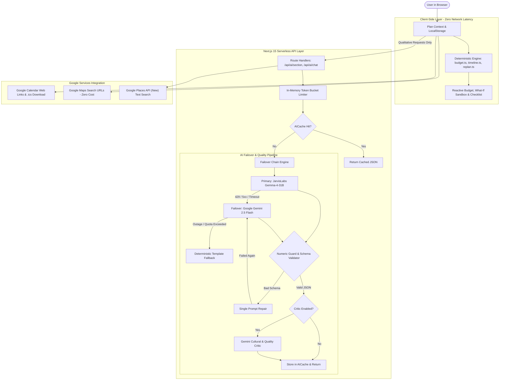

# Utsav Planner

> **AI-Assisted Cultural Celebration & Event Planner for India**  
> _Instant deterministic budgets, milestone schedules, zero-cost Google Maps vendor discovery, and safe LLM-powered creative copywriting._

[](https://github.com/CodeCatalyst-07/utsav_planner/actions)
[](https://opensource.org/licenses/MIT)
[](https://nodejs.org)
[](https://nextjs.org)

**Live Demo URL**: [https://utsav-planner.vercel.app](https://utsav-planner.vercel.app) _(Deploy your own in 2 minutes via [docs/deployment.md](docs/deployment.md))_

---

## 1. 90-Second Judge Walkthrough

1. **Launch**: Open [Live Demo](https://utsav-planner.vercel.app) and click **"Pune Maharashtrian Wedding"** to instantly load a realistic 200-guest, ₹25 Lakh cultural celebration plan.
2. **Deterministic Workspace**: Observe the **Plan Home** overview. The financial allocation, milestone countdown, and regional checklist are generated in 0 milliseconds with pure client-side math.
3. **What-If Sandbox (Zero Network Calls)**: Navigate to **Budget & What-If** (`/plan/budget`). Adjust the guest count stepper or input from 200 to 150. Notice how the budget reallocates live with zero network latency, mathematical precision, and instant audio-accessible screen reader announcements.
4. **AI Reliability & Failover**: On **Plan Home**, click **"Generate Creative Themes"**. The multi-provider failover chain tries JarvisLabs Gemma-4-31B -> Google Gemini -> Deterministic Template Fallback. The numeric guard guarantees the AI never invents fake prices or invalid dates.
5. **Calendar Integration**: Go to **Timeline** (`/plan/timeline`). Click **"Add to Google Calendar"** for an instant one-click event, or download the full celebration schedule as an RFC 5545 **`.ics`** file with reminder alarms.
6. **Vendor Discovery**: Visit **Vendors** (`/plan/vendors`). Browse curated sample listings with clear disclaimers, or click **"Open Google Maps Search"** to view real local businesses in Pune with zero API billing.
7. **Ask Assistant**: Navigate to **Ask** (`/plan/ask`). Type _"What if we increase the budget by 5 lakh?"_. The assistant suggests a structured patch; click **"Apply Patch"** to update your budget with full client-side state persistence.

---

## 2. Challenge Expectations & Technical Evidence

| Challenge Expectation                                | Implementation Strategy & Behavior                                                                                                                                                                                                                                                                                                                                                                                                                                                                                                                                         | Verifiable Code & Test Evidence                                                                                                                                                                                                                                                                                                                                    |
| :--------------------------------------------------- | :------------------------------------------------------------------------------------------------------------------------------------------------------------------------------------------------------------------------------------------------------------------------------------------------------------------------------------------------------------------------------------------------------------------------------------------------------------------------------------------------------------------------------------------------------------------------- | :----------------------------------------------------------------------------------------------------------------------------------------------------------------------------------------------------------------------------------------------------------------------------------------------------------------------------------------------------------------- |
| **1. Smart Dynamic Assistant**                       | Conversational assistant (`/plan/ask`) powered by Gemma via JarvisLabs with Gemini failover. Parses natural language intents, evaluates budget/guest/timeline trade-offs, generates structured patch proposals with live diff chips, and explains cultural customs.                                                                                                                                                                                                                                                                                                        | • [`src/domain/intents/parseIntent.ts`](src/domain/intents/parseIntent.ts)<br>• [`src/app/plan/ask/page.tsx`](src/app/plan/ask/page.tsx)<br>• [`tests/component/ask.test.tsx`](tests/component/ask.test.tsx)<br>• [`tests/unit/domain/intents.test.ts`](tests/unit/domain/intents.test.ts)                                                                         |
| **2. Logical Decision Making Based on User Context** | Mathematical deterministic planning engine deriving budgets, timelines, and checklists strictly from user context (city tier, guest count, dietary mix, budget tier, days to event). Zero invented prices or dates; Hamilton largest-remainder algorithm ensures zero-penny rounding loss.                                                                                                                                                                                                                                                                                 | • [`src/domain/rules/budget.ts`](src/domain/rules/budget.ts)<br>• [`src/domain/rules/timeline.ts`](src/domain/rules/timeline.ts)<br>• [`src/domain/rules/plan.ts`](src/domain/rules/plan.ts)<br>• [`tests/unit/domain/budget.test.ts`](tests/unit/domain/budget.test.ts)<br>• [`tests/unit/domain/timeline.test.ts`](tests/unit/domain/timeline.test.ts)           |
| **3. Effective Use of Google Services**              | Multi-service integration with graceful offline degradation:<br>• **Google Gemini 2.5 Flash**: Autonomous failover LLM (`src/server/ai/gemini.ts`) and optional critic (`src/server/ai/critic.ts`).<br>• **Google Calendar**: One-click URL generation and RFC 5545 `.ics` export with alarms (`src/server/google/calendar.ts`).<br>• **Google Maps**: Clean query search links for all vendor categories (`src/server/vendors/mapsLinks.ts`).<br>• **Google Places API (New)**: Structured text search adapter with basic field masking (`src/server/vendors/places.ts`). | • [`src/server/ai/gemini.ts`](src/server/ai/gemini.ts)<br>• [`src/server/google/calendar.ts`](src/server/google/calendar.ts)<br>• [`src/server/vendors/places.ts`](src/server/vendors/places.ts)<br>• [`tests/unit/server/contracts.test.ts`](tests/unit/server/contracts.test.ts)<br>• [`tests/unit/server/calendar.test.ts`](tests/unit/server/calendar.test.ts) |
| **4. Practical Real-World Usability**                | Built for real Indian celebration organizers:<br>• **Zero-latency What-If Sandbox**: Reallocates budgets in 0ms on the client with live screen reader announcements.<br>• **Fast 5-step Wizard**: Accessible stepper navigation with regional dietary scaling.<br>• **High Accessibility**: WCAG 2.1 AA/AAA compliance with 10.04:1 primary contrast on surface, 200% zoom reflow, and keyboard trap protection.<br>• **Zero Sign-In Friction**: 100% localStorage privacy with no mandatory accounts.                                                                     | • [`src/app/plan/budget/page.tsx`](src/app/plan/budget/page.tsx)<br>• [`src/app/plan/new/page.tsx`](src/app/plan/new/page.tsx)<br>• [`docs/accessibility.md`](docs/accessibility.md)<br>• [`tests/e2e/accessibility-deep.spec.ts`](tests/e2e/accessibility-deep.spec.ts)                                                                                           |
| **5. Clean & Maintainable Code**                     | Enterprise-grade codebase architecture:<br>• **Strict TypeScript**: 0 `any` types remaining across `src/`.<br>• **Modular File Footprint**: No file in `src/` exceeds 400 lines (excluding pure static data).<br>• **Comprehensive Test Coverage**: 412 unit and component tests passing, 12 eval scenarios + 6 adversarial negative tests, and Playwright end-to-end suite.<br>• **Minimal Duplication**: Code duplication measured at 3.14% by `jscpd`.                                                                                                                  | • [`src/server/ai/chain/`](src/server/ai/chain/)<br>• [`src/context/plan-reducer.ts`](src/context/plan-reducer.ts)<br>• [`evals/runner.ts`](evals/runner.ts)<br>• [`tests/unit/server/security.test.ts`](tests/unit/server/security.test.ts)                                                                                                                       |

---

## 3. Architecture & Operational Flow



---

## 4. Google Services Integration Matrix

| Google Service              | Implementation File                                                                                            | Role & Architectural Rationale                                                                                                                                                                | Graceful Degradation / Fallback                                                                                                    |
| :-------------------------- | :------------------------------------------------------------------------------------------------------------- | :-------------------------------------------------------------------------------------------------------------------------------------------------------------------------------------------- | :--------------------------------------------------------------------------------------------------------------------------------- |
| **Google Gemini (Gen AI)**  | [`src/server/ai/gemini.ts`](file:///Users/arnav/Desktop/event_planner/src/server/ai/gemini.ts)                 | **Autonomous Failover LLM**: Official `@google/genai` SDK provider invoked if JarvisLabs is down or returns HTTP 429/5xx. Free tier allows 20 req/day; Jarvis is primary, Gemini is failover. | Falls back cleanly to `DeterministicFallback`. Automatically parses Go duration retryDelay and opens circuit breaker.              |
| **Google Gemini Critic**    | [`src/server/ai/critic.ts`](file:///Users/arnav/Desktop/event_planner/src/server/ai/critic.ts)                 | **Quality & Dietary Auditor**: Secondary review evaluating dietary conflicts, budget tier mismatches, and cultural consistency.                                                               | Default disabled (`CRITIC_ENABLED=false`) to conserve free-tier quota. When active, failures degrade silently to `approved: true`. |
| **Google Search Grounding** | [`src/server/ai/grounding.ts`](file:///Users/arnav/Desktop/event_planner/src/server/ai/grounding.ts)           | **Live Auspicious Muhurat Context**: Optional search grounding for regional festival dates and cultural timings.                                                                              | Disabled by default (`GROUNDING_ENABLED=false`); returns `null` on error.                                                          |
| **Google Calendar**         | [`src/server/google/calendar.ts`](file:///Users/arnav/Desktop/event_planner/src/server/google/calendar.ts)     | **One-Click Event Links + RFC 5545 `.ics`**: Browser web links (`action=TEMPLATE`) with correct timezone offsets, plus downloadable `.ics` files with `VALARM` notifications.                 | Zero OAuth requirements; `.ics` export runs completely offline.                                                                    |
| **Google Maps**             | [`src/server/vendors/mapsLinks.ts`](file:///Users/arnav/Desktop/event_planner/src/server/vendors/mapsLinks.ts) | **Universal Local Search Links**: Clean encoded URLs (`https://www.google.com/maps/search/?api=1&query=...`) attached to all vendor categories.                                               | Zero billing, zero API keys, 100% uptime.                                                                                          |
| **Google Places API (New)** | [`src/server/vendors/places.ts`](file:///Users/arnav/Desktop/event_planner/src/server/vendors/places.ts)       | **Live Vendor Directory**: Text search (`places:searchText`) with basic field masks to keep API costs within the lower-tier Basic SKU.                                                        | Seamless fallback to curated sample listings and Google Maps links on error or unconfigured key.                                   |

---

## 5. Screens Gallery

1. **Start Screen (`/`)**: Direct entry point with zero-friction quick launches for pre-configured sample celebrations (Pune Maharashtrian Wedding, Indore Community Navratri, Mumbai Kids Birthday) or building a custom event from scratch.
2. **Event Blueprint Wizard (`/plan/new`)**: 5-step guided wizard with keyboard navigation, custom guest count scaling, city tier allocation, and dietary ratio selectors.
3. **Plan Workspace (`/plan`)**: Comprehensive dashboard highlighting countdown days, budget health, milestone progress, and AI-generated cultural themes.
4. **Budget & What-If Sandbox (`/plan/budget`)**: Interactive category breakdown with inline overrides, category why-formula explainers, and real-time What-If scenario modeling.
5. **Celebration Timeline (`/plan/timeline`)**: Milestone schedule organized by weeks and days out, complete with task completion toggles, Google Calendar export, and `.ics` download.
6. **Vendor Directory (`/plan/vendors`)**: Categorized vendor recommendations with honest sample labels, Google Maps search deep-links, and local area filters.
7. **Ask Event Assistant (`/plan/ask`)**: Conversational chat assistant that parses planning questions, verifies proposed patches against budget rules, and presents structured diff previews.

---

## 6. How We Test the LLM

Testing GenAI in production requires going beyond happy-path unit tests. Utsav Planner implements a comprehensive three-tier evaluation system:

### 1. 12 Culturally Neutral Evaluation Scenarios (`evals/`)

Located in [`evals/scenarios.ts`](file:///Users/arnav/Desktop/event_planner/evals/scenarios.ts), the eval suite covers diverse Indian celebrations across existing event types:

- **Weddings**: Pune Maharashtrian Traditional Wedding, Chennai Tamil Traditional Reception, Lucknow Awadhi Royal Wedding, Jaipur Destination Palace Wedding.
- **Birthdays (Kids & Adults)**: Mumbai 5th Birthday, Hyderabad Toddler Party, Kolkata 30th Birthday, Ahmedabad 50th Milestone Celebration (with strict Jain requirements), Bengaluru 60th Milestone.
- **Community Festivals**: Mumbai Ganeshotsav Pandal, Indore Navratri Garba, Delhi Diwali Cultural Mela.

### 2. Dual-Mode Positive & Adversarial Negative Evals

Run via `pnpm eval`:

- **Positive Tests**: Asserts that real or template outputs pass schema validation, numeric bounds, allowed category IDs, and dietary requirements.
- **Adversarial Negative Poison Tests**: Injects 6 deliberate security and domain violations:
  1. _Meat in Pure-Veg Menu_: Chicken injected into a vegetarian profile (`nonVeg === 0`) -> **Strictly blocked by semantic validator**.
  2. _Root Vegetables in Jain Counter_: Potato/Garlic injected into a Jain counter (`jain > 0`) -> **Strictly blocked by Jain keyword validator**.
  3. _Hallucinated Rupee Amounts_: Injected `₹9,99,999` not in profile or diff facts -> **Strictly blocked by Numeric Guard**.
  4. _API Key Leakage_: Injected secret key pattern into output prose -> **Strictly blocked by Secret Leak Scanner**.
  5. _Out-of-Bounds Chat Patch_: Negative guest counts or budget > ₹50 Cr -> **Strictly blocked by Zod schema**.
  6. _Unauthorized Category IDs_: Hallucinated category IDs -> **Strictly blocked by Domain Validator**.

### 3. Live LLM Probe & Diagnostics (`scripts/probe-llm.ts`)

Run via `pnpm probe:llm`:

- Benchmarks live provider latencies, finish reasons, token consumption, and reasoning configurations.
- Demonstrates that disabling Gemma thinking tokens via `{"chat_template_kwargs":{"enable_thinking":false}}` cuts latency (345ms vs 968ms), but default reasoning (`{}`) is kept active because complex multi-course dietary menu validity requires thinking tokens to achieve 100% first-attempt success (without thinking, menu validity drops to 80%).

---

## 7. Security & Data Privacy Summary

- **Zero Server-Side Storage**: Utsav Planner maintains no database. All event plans and chat history are saved exclusively in the user's browser `localStorage`.
- **Strict Content Security Policy (CSP)**: Zero eval violations achieved through Zod `jitless: true` configuration, nosniff, frame-ancestors 'none', HSTS, and no X-Powered-By header.
- **Client Bundle Secret Grep**: Automated post-build sweeps ensure `JARVISLABS_API_KEY`, `GEMINI_API_KEY`, and `GOOGLE_PLACES_API_KEY` never appear in `.next/static`.
- Full details available in [`SECURITY.md`](SECURITY.md).

---

## 8. Development & Testing Quickstart

```bash
# Install dependencies
pnpm install

# Run type check and linter
pnpm typecheck
pnpm lint

# Run unit tests with coverage
pnpm test:coverage

# Run LLM evaluation harness (12 scenarios + 6 poisoned negative tests)
pnpm eval

# Run Playwright end-to-end tests
pnpm test:e2e

# Run API smoke test against deployed or local server
BASE_URL=http://localhost:3000 pnpm smoke:api
```

---

## 9. License

This project is licensed under the MIT License - see the [`LICENSE`](LICENSE) file for details.
