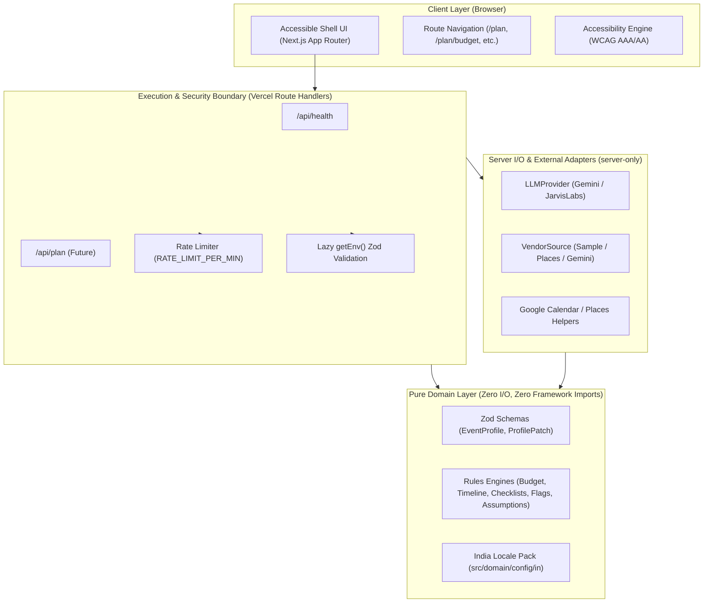
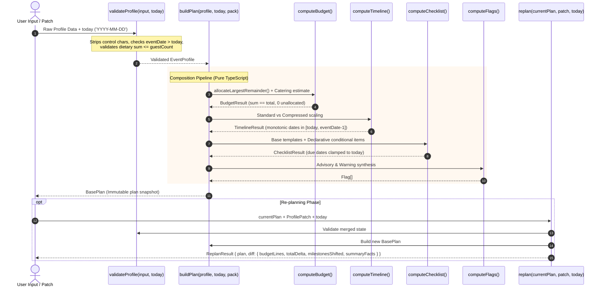

# System Architecture (`docs/architecture.md`)

## Overview

**Utsav Planner** is structured following Clean Architecture principles adapted for the Next.js App Router and serverless deployment on Vercel.

---

## Domain Data Flow: `profile -> validate -> buildPlan -> replan diff`

The Rules Engine (`src/domain/`) operates as a completely deterministic, side-effect-free pipeline:

---

## Architectural Layers

1. **Client / UI (`src/app/`, `src/components/`)**:
   - Server and Client components utilizing semantic HTML5 landmarks (`header`, `nav`, `main#main-content`, `footer`).
   - Single `<h1>` per view, visible high-contrast focus rings, touch targets ≥ 44px.
   - Warm editorial design system with strict color token isolation.

2. **Server Boundaries (`src/app/api/`, `src/server/`)**:
   - Sealed by `import 'server-only'`.
   - Never leaks secret keys or exposes unredacted error messages.
   - Route handlers validate inbound requests against Domain schemas before dispatching to services.

3. **Pure Domain (`src/domain/`)**:
   - Zero side-effects, zero network calls, zero UI imports.
   - Guarded by ESLint `no-restricted-imports` prohibiting imports of `next`, `react`, `server-only`, or `src/server`.
   - Injected explicit `today: string` ('YYYY-MM-DD'); zero reliance on `Date.now()`.
   - Integer rupee calculations via Largest Remainder algorithm (`allocateLargestRemainder`).
   - Deterministic calculations for Indian celebrations.

4. **External Services (`src/server/llm/`, `src/server/vendors/`, `src/server/google/`)**:
   - Unified provider interfaces with swappable adapters.
   - Default fallbacks (`SampleVendorSource`) allow running offline without paid external services.
