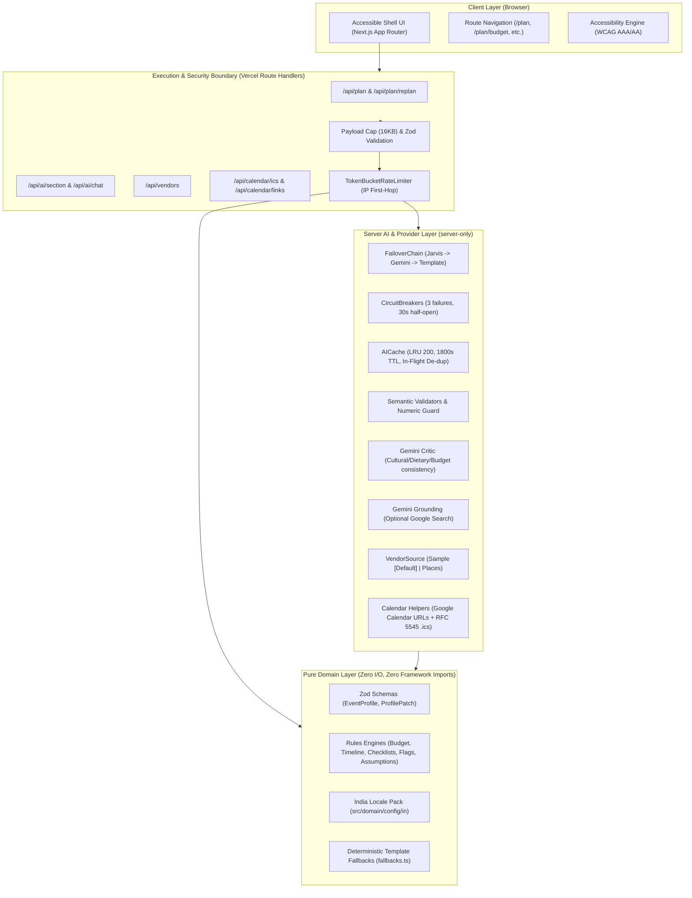
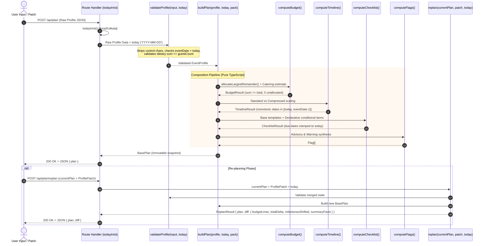
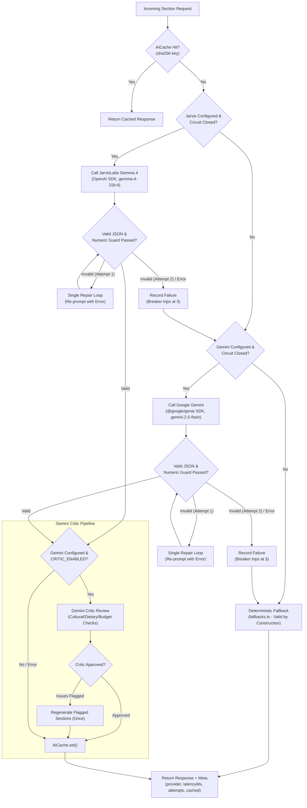
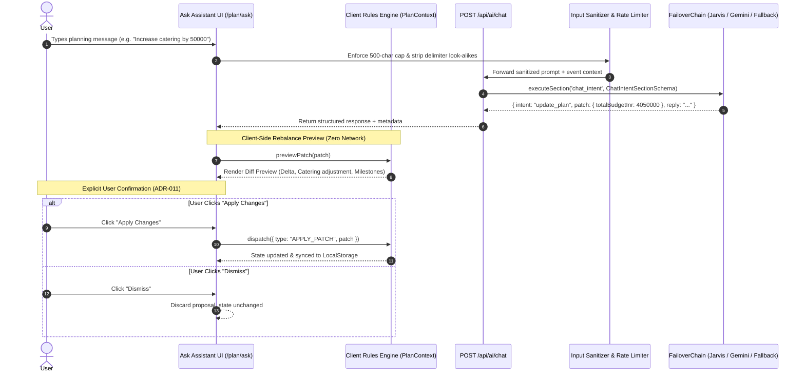

# System Architecture (`docs/architecture.md`)

## Overview

**Utsav Planner** is structured following Clean Architecture principles adapted for the Next.js App Router and serverless deployment on Vercel.

### Client / Server Execution Split

1. **Client-Side Execution (Browser)**:
   - **Deterministic Planning Engine**: `src/domain/` is pure TypeScript with zero Node or Next.js I/O dependencies. It is imported directly by React client components (`src/context/plan-context.tsx`, `src/app/plan/budget/page.tsx`, `src/app/plan/timeline/page.tsx`, `src/app/plan/vendors/page.tsx`, `src/app/plan/ask/page.tsx`).
   - **Instant What-If Sandbox**: Recalculating budget splits, catering estimates, and timeline adjustments executes locally in ~1ms with **zero network calls**.
   - **Local-First Privacy**: User profiles, category overrides, milestone completion IDs, and booked vendor IDs are persisted exclusively to browser `localStorage` (`utsav_plan_v2` with seamless migration from `utsav_plan_v1`). No user accounts, database tables, or server persistence exist.
   - **Sample Mode Isolation**: Prospective users can explore sample profiles in an in-memory sandbox without mutating or overwriting saved celebration blueprints.
   - **Client Date Boundary**: `src/lib/today.ts` provides `todayInIst()` using browser `Intl` with `timeZone: 'Asia/Kolkata'`, preventing client components from importing server date modules.
   - **Interactive Milestone & Vendor Progress**: Vertical rail timeline with month grouping, past milestone catch-up detection, Google Calendar 1-click links, and vendor booking progress tracking.
   - **Assistant Confirmation Safety Boundary**: Natural language queries to the assistant (`/plan/ask`) extract intents deterministically and calculate rebalance diffs. Proposed changes require explicit user confirmation ("Apply change") and are never silently auto-applied.
2. **Server-Side Execution (Route Handlers)**:
   - **Qualitative GenAI (`/api/ai/section`, `/api/ai/chat`)**: The only network calls invoked by the interactive workspace are on-demand qualitative themes/ideas, category saving tips, and course menus, plus conversational chat assistance.
   - **Provider Failover & Guardrails**: JarvisLabs Gemma 4 failover to Google Gemini Flash, semantic validation, numeric hallucination guards, and Gemini Critic evaluation run strictly behind `import 'server-only'`.
   - **Offline Calendar & Map Exports (`/api/calendar/ics`, `/api/calendar/links`, `/api/vendors`)**: Offline RFC 5545 `.ics` file generation and Google Maps universal directory search links.

---

## Domain Data Flow: `profile -> validate -> buildPlan -> replan diff`

The Rules Engine (`src/domain/`) operates as a completely deterministic, side-effect-free pipeline:

---

## AI Generation & Failover Architecture

The AI layer generates qualitative content (creative ideas, category tips, menus, diff narration, chat intent) using strict schema extraction, numerical guards, circuit breakers, and deterministic fallback.

---

## Conversational Chat Flow & Safety

The Ask Event Assistant (`/plan/ask`) provides conversational planning assistance and structured plan modification suggestions. It enforces strict separation between generative suggestions and transactional plan mutations.

### Safety Guarantees for Chat Flow

1. **No Autonomous State Mutation**: The LLM _cannot_ directly modify the plan state or database. It can only propose structured patches matching `PlanPatchSchema`.
2. **Explicit User Confirmation (ADR-011)**: Every proposed plan change requires an explicit user click on the "Apply Changes" button.
3. **Passive Context Sandbox**: Free-text notes and conversational messages are wrapped in `<user_notes>` tags. System instructions strictly instruct the model to treat user text as passive context rather than administrative commands.
4. **Numeric Guard**: Chat replies cannot invent unverified numbers or commercial guarantees.

---

## Google Services Integration Matrix

| Service                     | Component & Path                  | Role & Operational Rationale                                                                                                                                                               | Graceful Degradation / Fallback                                                                           |
| :-------------------------- | :-------------------------------- | :----------------------------------------------------------------------------------------------------------------------------------------------------------------------------------------- | :-------------------------------------------------------------------------------------------------------- |
| **Google Gemini (Gen AI)**  | `src/server/ai/critic.ts`         | **Load-Bearing Critic**: Post-generation review of generated themes, menus, and tips to prevent cultural contradictions, dietary mismatches, and budget incoherence.                       | Failures degrade silently; never blocks user response.                                                    |
| **Google Gemini (Gen AI)**  | `src/server/ai/gemini.ts`         | **Failover LLM Provider**: Automatically receives traffic if JarvisLabs rates-limits (429), errors (5xx), or times out.                                                                    | Falls back to `DeterministicFallback` if Gemini is also unavailable.                                      |
| **Google Gemini (Gen AI)**  | `src/server/ai/grounding.ts`      | **Google Search Grounding**: Dynamic lookup of regional Indian festival dates, muhurat context, and traditional customs. Labeled "confirm with local calendar/priest".                     | Behind `GROUNDING_ENABLED=false` by default; returns `null` on error.                                     |
| **Google Calendar**         | `src/server/google/calendar.ts`   | **Direct Links + RFC 5545 `.ics`**: One-click Google Calendar web links (`action=TEMPLATE`) with exclusive end dates, plus universal `.ics` file generation with `VALARM` reminder alerts. | Direct links require zero authentication; `.ics` downloads run completely offline.                        |
| **Google Maps**             | `src/server/vendors/mapsLinks.ts` | **Universal Search Links**: Pure URL builders (`https://www.google.com/maps/search/?api=1&query=...`) attached to all vendor results.                                                      | Requires zero API keys and zero billing.                                                                  |
| **Google Places API (New)** | `src/server/vendors/places.ts`    | **Live Vendor Directory**: Text search (`places:searchText`) with minimal field mask (`id, displayName, formattedAddress, googleMapsUri`) and 5-result cap.                                | Falls back immediately to `SampleVendorSource` + Google Maps search links on 429, error, or unconfigured. |

---

## Security & Privacy Envelopes

1. **Server-Only Isolation (`import 'server-only'`)**:
   - All code in `src/server/` cannot be imported by client components or leaked into browser bundles.
2. **Numeric Guard**:
   - The LLM writes only qualitative prose. Any number token (including formatted numbers like `15,000`, spoken terms like `lakh`/`crore`, and currency symbols `₹`/`Rs`) generated by the model must exist within the allowed context set extracted from the deterministic plan. If an unauthorized number appears, the output is rejected.
3. **Untrusted Data Boundaries**:
   - User notes are sanitized of delimiter look-alikes (`</user_notes>`, `<user_notes>`) and enclosed in structural delimiters. Prompts contain only high-level counts and categories—never guest names, phone numbers, or user PII.
4. **Secret Redaction**:
   - Structured JSON logging (`src/server/security/logger.ts`) redacts all known environment secret values and never logs raw prompts, user notes, or credentials.
5. **Rate Limiting & Payload Caps**:
   - Request bodies are strictly capped at 16KB.
   - Client IPs (extracted safely from first-hop `x-forwarded-for`) are rate-limited via in-memory token buckets (10 req/min for AI routes; 60 req/min for engine routes).
